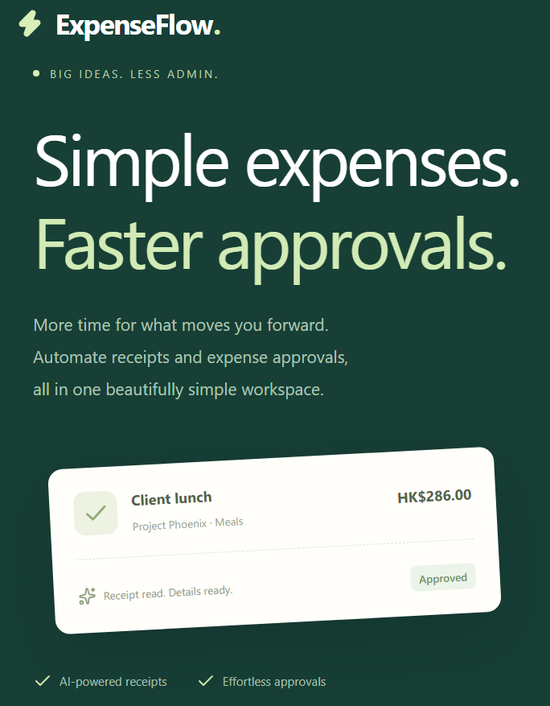

# ExpenseFlow

<figure>
  
  <figcaption>Big ideas, less admin. Keep everyday business spending moving.</figcaption>
</figure>

ExpenseFlow is a continuous expense management platform designed for small and medium-sized businesses. Bring day-to-day spending and financial follow-up into one clear workflow, so teams can spend less time chasing paperwork and more time running the business.

## Keep financial work moving

- Organize business expenses and supporting records as they happen.
- Scan receipts to capture expense details and turn paper slips into organized digital records.
- Use AI-assisted follow-up to keep receivables and payables from falling through the cracks.
- Prepare structured records for compliant tax filing and audit reporting.
- Give teams a simpler way to submit and approve expenses.

Explore the [ExpenseFlow demo](https://expenseflow-demo-red.vercel.app/login).

## Ask about a trial

For product questions or to request a trial account, email [support@aionelab.com](mailto:support@aionelab.com).
